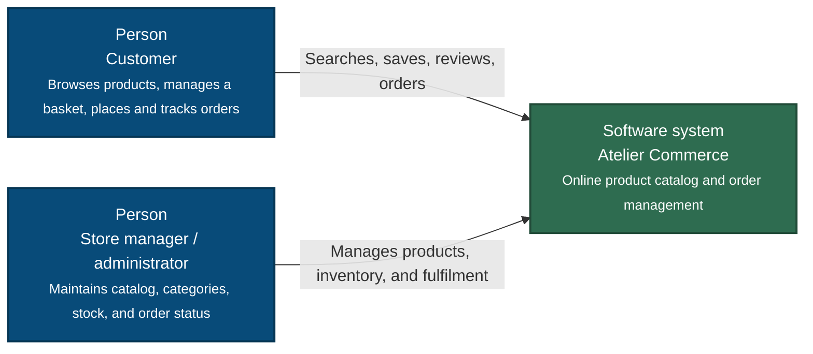
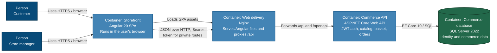
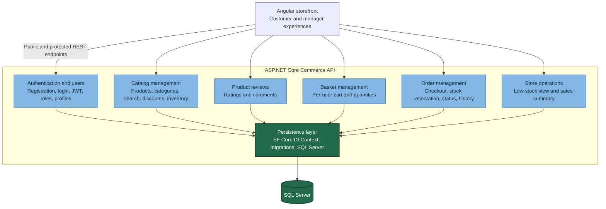
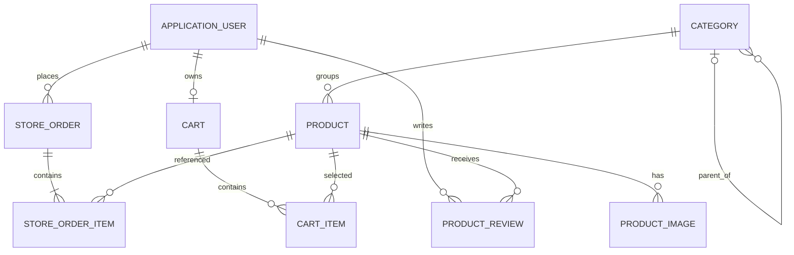

# C4 model

The diagrams describe the e-commerce application at three C4 zoom levels. The model follows the C4 concepts in the supplied architecture guide: people use a software system; deployable applications and data stores are containers; related implementation responsibilities inside an application are components.

## Level 1 — System context

## Level 2 — Containers

## Level 3 — API components

## Domain data view

This is a supporting entity view, not a fourth C4 diagram. The C4 guide describes the code-level view as optional; this relationship view makes the SQL model easier to review.

### Boundaries and assumptions

- The Angular application keeps guest basket state in browser storage; signed-in baskets are stored through the API.
- The API owns authorization and validates inventory at checkout. The browser is not trusted to set order totals.
- SQL Server is the durable store. The API applies EF Core migrations at startup and seeds sample catalog data once.
- The brief marks payment-gateway integration optional. This version records cash on delivery and does not connect to a payment provider.
- Product seed photos use remote Unsplash image URLs; replace them with owned or licensed media for a deployed shop.
